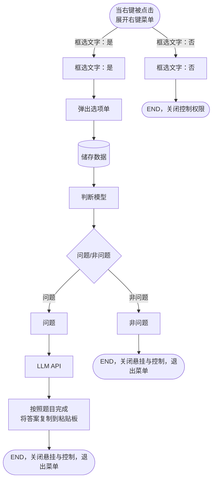

FLOW-TASK: build-software/desktop-python
FLOW-TARGET: 划词作答助手（自动作答流程） | source: 自动作答流程.ngm | stack: Python 3.10+ / tkinter / SQLite / OpenAI 兼容 API（推断） | entry: S1 | end: S10
FLOW-RULE: 顺序执行 S1→S14；每步验收通过后勾选 STATUS；判断按实测分支；无选区走 S11，非问题走 S13

# 划词作答助手 · 构建逻辑

> 来源: `自动作答流程.ngm`（ZIP 内为 draw.io XML）｜ 节点: 14 ｜ 边: 13（其中 2 条由悬空边还原）｜ 生成: 2026-11-05

## 0. 任务卡

- **构建什么**: 一个常驻 Windows 的划词作答工具：选中文字后点右键，光标旁弹出选项单；判断是不是题目；是题就调用 LLM 流式作答并写入剪贴板。
- **成功标志**: 选中题目文字 → 右键 → 面板出现 → 作答 → `Ctrl+V` 可粘贴答案；空白处右键不打扰系统菜单；非题目自动收起面板。
- **非目标**: 不做 OCR、不做图片题、不自动提交、不模拟点击。
- **运行环境**: Windows 10/11 x64，Python 3.10+，tkinter 自带，SQLite 标准库。
- **外部依赖**: 一个 OpenAI 兼容的 LLM 接口（地址 + API Key + 模型名）。

## 1. 执行契约

- 按 S 编号施工；§5 的分支步骤只在触发条件成立时执行。
- 每步完成后运行 `- 验收:`，通过才把 §8 的 `[ ]` 改成 `[x]`。
- 判断步骤必须实测，不允许按“应该会”选分支。
- 同一个任务只允许一个作答流程；新任务开始时取消旧任务。
- 遇到逻辑 MD 与实际环境冲突，停止并写 §9，不自行扩大范围。
- 实现顺序允许按依赖调整，但不得跳步或合并验收。

## 2. 节点清单

> 为可读性，把原图 ID `tVlFIiZHW1Jl-oZgzjHy-*` 映射为 `N1..N14`；映射见“备注”。

| 节点ID | 功能头 | 原文标签 | 类型 | 入度 | 出度 | 软件落点 | 备注 |
| --- | --- | --- | --- | --- | --- | --- | --- |
| N1 | START | 当右键被点击 展开右键菜单 | start | 0 | 2 | `snapanswer/win32.py` | 原 `-1` |
| N2 | INPUT | 框选文字：否 | process | 1 | 1 | `snapanswer/selection.py` | 原 `-2`，图中为 decision 形状，作分支标签 |
| N3 | INPUT | 框选文字：是 | process | 1 | 1 | `snapanswer/selection.py` | 原 `-3`，图中为 decision 形状，作分支标签 |
| N4 | END | END，关闭控制权限 | end | 1 | 0 | `snapanswer/win32.py` | 原 `-6` |
| N5 | PRINT | 弹出选项单 | io | 1 | 1 | `snapanswer/ui.py` | 原 `-8` |
| N6 | DB | 储存数据 | database | 1 | 1 | `snapanswer/store.py` | 原 `-13` |
| N7 | PREPARE | 判断模型 | process | 1 | 1 | `snapanswer/intel.py` | 原 `-15`，图中为箭头形状 |
| N8 | DQ | 问题/非问题 | decision | 1 | 2 | `snapanswer/intel.py` | 原 `-17` |
| N9 | PRINT | 非问题 | process | 1 | 1 | `snapanswer/intel.py` | 原 `-23`，图中为平行四边形 |
| N10 | DATA | 问题 | process | 1 | 1 | `snapanswer/intel.py` | 原 `-24`，图中为平行四边形 |
| N11 | END | END，关闭悬挂与控制，退出菜单 | end | 1 | 0 | `snapanswer/pipeline.py` | 原 `-27`，非问题结束 |
| N12 | TRANSMUTE | LLM API | process | 1 | 1 | `snapanswer/intel.py` | 原 `-29`，图中为箭头形状 |
| N13 | PRINT | 按照题目完成 将答案复制到粘贴板 | io | 1 | 1 | `snapanswer/ui.py`、`snapanswer/win32.py` | 原 `-31` |
| N14 | END | END，关闭悬挂与控制，退出菜单 | end | 1 | 0 | `snapanswer/pipeline.py` | 原 `-34`，成功结束 |

## 3. 边清单

| From | To | 条件/标签（原文） | 边类型 |
| --- | --- | --- | --- |
| N1 | N3 | 框选文字：是 | yes |
| N1 | N2 | 框选文字：否 | no |
| N3 | N5 |  | normal |
| N2 | N4 |  | normal |
| N5 | N6 |  | normal |
| N6 | N7 |  | normal |
| N7 | N8 |  | normal |
| N8 | N10 | 问题 | yes |
| N8 | N9 | 非问题 | no |
| N10 | N12 |  | normal |
| N9 | N11 |  | normal |
| N12 | N13 |  | normal |
| N13 | N14 |  | normal |

> 注：`N5 → N6` 与 `N7 → N8` 在原图中只有 `source`，没有 `target`；其 `targetPoint` 分别落在 N6、N8 的左边缘中心，按几何位置还原为这两条边，详见 §9。

## 4. 构建步骤

### S1 {START}{DQ} · 触发：右键点击并判断框选结果
- 节点: N1 (start)
- 目标: 捕获右键事件，判断是否成功框选文字
- 落点: `snapanswer/win32.py`、`snapanswer/selection.py`
- 动作: 安装低级鼠标钩子；成对接管右键 DOWN/UP；调用选区探测
- 输入: 鼠标事件、当前前台窗口、剪贴板
- 产出: `probe_selection() -> str | None`
- 判定: `probe_selection()` 返回非空且非纯空白文本
- 是（框选文字：是）→ S2
- 否（框选文字：否）→ S11
- 验收: 选中文本右键走 S2；空白处右键走 S11，且不破坏剪贴板

### S2 {INPUT} · 框选文字：是
- 节点: N3 (process)
- 目标: 保存选区文本、光标位置和来源应用
- 落点: `snapanswer/selection.py`
- 动作: 规范化文本；记录光标坐标；生成 Capture 数据
- 输入: 选区探测结果
- 产出: `Capture(text, x, y, app)`
- 验收: 选中 `hello` 右键，`Capture.text == "hello"`
- 下一步: S3

### S3 {PRINT} · 弹出选项单
- 节点: N5 (io)
- 目标: 在光标右下角显示选项单，不阻断原应用
- 落点: `snapanswer/ui.py`
- 动作: 无边框置顶窗口；显示状态文案与「作答 / ✕」；Esc 可关闭
- 输入: Capture、光标坐标
- 产出: `OptionPanel.show()` / `hide()`
- 验收: 面板在光标右下角 300ms 内出现，Esc 可关闭
- 下一步: S4

### S4 {DB}{STORGE} · 储存数据
- 节点: N6 (database)
- 目标: 把本次捕获写入本地历史库
- 落点: `snapanswer/store.py`
- 动作: 建 `captures` 表；实现 `insert_capture()`；按保留天数清理
- 输入: Capture
- 产出: `history.db` 中的一行记录
- 验收: 查询最近一条 `captures` 记录，文本与本次选区一致
- 下一步: S5

### S5 {PREPARE} · 判断模型
- 节点: N7 (process)
- 目标: 为本次任务选择判题模型与作答模型
- 落点: `snapanswer/intel.py`
- 动作: 读取配置；按题目类型路由；记录本次选中的模型名
- 输入: Capture、模型配置
- 产出: `model_name`、`judge_model`
- 验收: 默认配置返回默认模型；配置了推理模型时，数学题走推理模型
- 下一步: S6

### S6 {DQ} · 判断：问题/非问题
- 节点: N8 (decision)
- 目标: 过滤非题目，避免无意义调用
- 落点: `snapanswer/intel.py`
- 判定: 判题模型返回 `is_question=true` 且置信度不低于配置阈值
- 是（问题）→ S7
- 否（非问题）→ S13
- 验收: 题目文本走 S7；普通文本走 S13

### S7 {DATA} · 问题
- 节点: N10 (process)
- 目标: 进入作答分支，组装请求
- 落点: `snapanswer/intel.py`
- 动作: 拼接系统提示与题目文本；准备流式请求参数
- 输入: 题目文本、model_name
- 产出: 非空 prompt 与请求体
- 验收: 题目文本生成的 prompt 非空，且包含原题
- 下一步: S8

### S8 {TRANSMUTE} · LLM API
- 节点: N12 (process)
- 目标: 调用 LLM 流式生成答案
- 落点: `snapanswer/intel.py`
- 动作: POST OpenAI 兼容 `/chat/completions`，`stream=true`；处理超时、401、429；拼接 token
- 输入: prompt、model_name、API Key
- 产出: 流式回调 + 完整答案字符串
- 验收: 假 LLM 服务返回流式内容，客户端能拼接出完整答案
- 下一步: S9

### S9 {PRINT} · 按照题目完成，将答案复制到粘贴板
- 节点: N13 (io)
- 目标: 展示答案并让用户可以直接粘贴
- 落点: `snapanswer/ui.py`、`snapanswer/win32.py`
- 动作: 流式展示答案；完成后写入剪贴板；关闭面板并把焦点还给原窗口
- 输入: 完整答案
- 产出: 剪贴板内容 = 答案
- 验收: 作答后 `Ctrl+V` 能粘贴出答案；面板不可见
- 下一步: S10

### S10 {END} · END，关闭悬挂与控制，退出菜单（成功）
- 节点: N14 (end)
- 目标: 成功收尾，等待下次触发
- 落点: `snapanswer/pipeline.py`
- 动作: 清理任务 ID、取消标志、临时钩子状态
- 验收: 连续触发两次，第二次不会复用第一次的答案
- 结果: 任务成功结束，进程继续驻留

## 5. 分支与异常

### S11 {INPUT} · 框选文字：否
- 节点: N2 (process)
- 触发: S1 = 否
- 目标: 不接管这次右键，让系统菜单正常出现
- 落点: `snapanswer/win32.py`
- 动作: 成对重放鼠标 DOWN/UP 到原坐标；不弹自定义面板
- 验收: 空白处右键出现系统菜单，鼠标不卡键
- 下一步: S12

### S12 {END} · END，关闭控制权限
- 节点: N4 (end)
- 触发: S11 完成
- 目标: 结束本次右键，不残留控制状态
- 落点: `snapanswer/win32.py`
- 动作: 释放本次钩子状态；恢复输入；不写历史
- 验收: 结束后左键、右键均正常，无面板，剪贴板不变
- 结果: 本次右键结束

### S13 {PRINT} · 非问题
- 节点: N9 (process)
- 触发: S6 = 否
- 目标: 不进入作答，收起面板
- 落点: `snapanswer/ui.py`
- 动作: 关闭面板；可选显示短暂“不是题目”提示
- 验收: 非题目文本右键后 1 秒内面板消失，剪贴板不变
- 下一步: S14

### S14 {END} · END，关闭悬挂与控制，退出菜单（非问题）
- 节点: N11 (end)
- 触发: S13 完成
- 目标: 结束非问题分支
- 落点: `snapanswer/pipeline.py`
- 动作: 清理状态；不发起 LLM 请求
- 验收: 日志中没有本次 LLM 请求；剪贴板与任务开始前一致
- 结果: 非问题分支结束

## 6. 循环与并行

无。本流程没有回边；捕获与作答没有 fork/join，按单任务串行处理。

## 7. 验收门槛

### G1 · 静态检查
- 命令: `python -m compileall snapanswer`
- 通过: 退出码 0
- 失败: 回到报错文件对应的 S 步骤

### G2 · 离线自检
- 命令: `python tools/selfcheck.py`
- 通过: 退出码 0；若项目尚未实现该脚本，本条暂记 `【推断】`，用 G3 代替
- 失败: 回到失败用例对应的 S 步骤

### G3 · 交互验收
- 命令: `python run.py`
- 通过: 选中文本右键弹出面板并完成作答；空白处右键出现原生菜单；非题目面板自动收起；剪贴板可粘贴答案
- 失败: 按现象回到 S1/S3/S8/S9 检查

## 8. 执行状态

- [ ] S1 · 触发：右键点击并判断框选结果
- [ ] S2 · 框选文字：是
- [ ] S3 · 弹出选项单
- [ ] S4 · 储存数据
- [ ] S5 · 判断模型
- [ ] S6 · 判断：问题/非问题
- [ ] S7 · 问题
- [ ] S8 · LLM API
- [ ] S9 · 按照题目完成，将答案复制到粘贴板
- [ ] S10 · END，关闭悬挂与控制，退出菜单（成功）
- [ ] S11 · 框选文字：否
- [ ] S12 · END，关闭控制权限
- [ ] S13 · 非问题
- [ ] S14 · END，关闭悬挂与控制，退出菜单（非问题）

## 9. 待确认

- 【约定】功能头按《关于逻辑md的功能头字符》映射：`{START}` 开始、`{DQ}` 判断、`{DB}{STORGE}` 储存、`{TRANSMUTE}` 传输、`{END}` 结束；N1 同时承担入口和分支判断，使用 `{START}{DQ}`。
- 【解析】源文件 `自动作答流程.ngm` 是 ZIP 容器，内部 `data.ngm` 为 draw.io `mxfile` XML；节点/边由脚本直接解析，不是 OCR 或猜测。
- 【推断】原图 `N5 → N6` 的边（XML id `...-12`）只有 `source`，没有 `target`；`targetPoint (500,320)` 落在 N6 左边缘中心，按几何位置还原为 `弹出选项单 → 储存数据`。
- 【推断】原图 `N7 → N8` 的边（XML id `...-18`）只有 `source`，没有 `target`；`targetPoint (740,320)` 落在 N8 左边缘中心，按几何位置还原为 `判断模型 → 问题/非问题`。
- 【推断】N2/N3 在原图中是 decision 形状，但内容分别是“框选文字：否/是”，实际承担分支标签；编译为 process 分支步骤，判断放在 S1。
- 【推断】N9/N10 在原图中是平行四边形，但内容是“非问题/问题”，实际是判断结果；编译为 process 分支步骤。
- 【推断】N5「弹出选项单」与 N13「复制到粘贴板」在原图中是圆角矩形，按 IO 边界编译为 io 步骤。
- 【推断】技术栈参考同目录 `snapanswer` 项目：Python 3.10+ / tkinter / SQLite / OpenAI 兼容 API；原图未写技术栈。
- [`?`] N7「判断模型」的具体路由规则图里没写；暂按“判题模型 + 可选取推理模型”实现，阈值和规则见配置。
- [`?`] N1「展开右键菜单」与 N5「弹出选项单」是否为同一个菜单不明确；当前实现为：N1 是系统右键触发，N5 是自定义选项单。
- [`?`] N11 与 N14 标签完全相同，但分别属于“非问题”和“成功”两条结束路径；执行时以节点 ID 区分，不要合并。

## 10. 回环图



## 附录：flow-json

```flow-json
{
  "name": "自动作答流程",
  "task": "build-software/desktop-python",
  "source": "自动作答流程.ngm",
  "nodes": [
    { "id": "N1", "label": "当右键被点击 展开右键菜单", "type": "start", "directive": "START", "directives": ["START", "DQ"] },
    { "id": "N2", "label": "框选文字：否", "type": "process", "directive": "INPUT" },
    { "id": "N3", "label": "框选文字：是", "type": "process", "directive": "INPUT" },
    { "id": "N4", "label": "END，关闭控制权限", "type": "end", "directive": "END" },
    { "id": "N5", "label": "弹出选项单", "type": "io", "directive": "PRINT" },
    { "id": "N6", "label": "储存数据", "type": "database", "directive": "DB", "directives": ["DB", "STORGE"] },
    { "id": "N7", "label": "判断模型", "type": "process", "directive": "PREPARE" },
    { "id": "N8", "label": "问题/非问题", "type": "decision", "directive": "DQ" },
    { "id": "N9", "label": "非问题", "type": "process", "directive": "PRINT" },
    { "id": "N10", "label": "问题", "type": "process", "directive": "DATA" },
    { "id": "N11", "label": "END，关闭悬挂与控制，退出菜单", "type": "end", "directive": "END" },
    { "id": "N12", "label": "LLM API", "type": "process", "directive": "TRANSMUTE" },
    { "id": "N13", "label": "按照题目完成 将答案复制到粘贴板", "type": "io", "directive": "PRINT" },
    { "id": "N14", "label": "END，关闭悬挂与控制，退出菜单", "type": "end", "directive": "END" }
  ],
  "edges": [
    { "from": "N1", "to": "N3", "label": "框选文字：是", "kind": "yes" },
    { "from": "N1", "to": "N2", "label": "框选文字：否", "kind": "no" },
    { "from": "N3", "to": "N5", "label": "", "kind": "normal" },
    { "from": "N2", "to": "N4", "label": "", "kind": "normal" },
    { "from": "N5", "to": "N6", "label": "", "kind": "normal" },
    { "from": "N6", "to": "N7", "label": "", "kind": "normal" },
    { "from": "N7", "to": "N8", "label": "", "kind": "normal" },
    { "from": "N8", "to": "N10", "label": "问题", "kind": "yes" },
    { "from": "N8", "to": "N9", "label": "非问题", "kind": "no" },
    { "from": "N10", "to": "N12", "label": "", "kind": "normal" },
    { "from": "N9", "to": "N11", "label": "", "kind": "normal" },
    { "from": "N12", "to": "N13", "label": "", "kind": "normal" },
    { "from": "N13", "to": "N14", "label": "", "kind": "normal" }
  ],
  "steps": [
    { "id": "S1", "node": "N1", "next": ["S2", "S11"] },
    { "id": "S2", "node": "N3", "next": ["S3"] },
    { "id": "S3", "node": "N5", "next": ["S4"] },
    { "id": "S4", "node": "N6", "next": ["S5"] },
    { "id": "S5", "node": "N7", "next": ["S6"] },
    { "id": "S6", "node": "N8", "next": ["S7", "S13"] },
    { "id": "S7", "node": "N10", "next": ["S8"] },
    { "id": "S8", "node": "N12", "next": ["S9"] },
    { "id": "S9", "node": "N13", "next": ["S10"] },
    { "id": "S10", "node": "N14", "next": [] },
    { "id": "S11", "node": "N2", "next": ["S12"] },
    { "id": "S12", "node": "N4", "next": [] },
    { "id": "S13", "node": "N9", "next": ["S14"] },
    { "id": "S14", "node": "N11", "next": [] }
  ],
  "loops": [],
  "assumptions": [
    "【推断】N5→N6 由悬空边 targetPoint(500,320) 还原",
    "【推断】N7→N8 由悬空边 targetPoint(740,320) 还原",
    "【推断】技术栈参考同目录 snapanswer 项目"
  ],
  "unresolved": [
    "[?] N7 判断模型的具体路由规则未给出",
    "[?] N1 展开右键菜单与 N5 弹出选项单的关系需确认",
    "[?] N11 与 N14 标签相同，执行时按节点 ID 区分"
  ]
}
```
