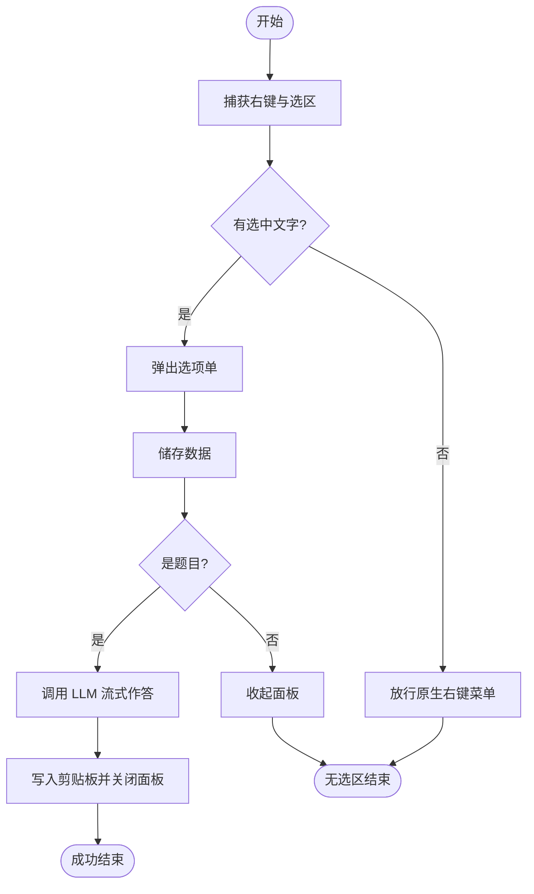

FLOW-TASK: build-software/desktop-python
FLOW-TARGET: 划词作答助手 SnapAnswer | source: 自动作答流程.ngm | stack: Python 3.10+ / tkinter / SQLite / OpenAI 兼容 API | entry: S1 | end: S9
FLOW-RULE: 顺序执行 S1→S12；每步验收通过后勾选 STATUS；判断按实测分支；失败走 §5；范围外变更先问

# 划词作答助手 · 构建逻辑

> 来源: `自动作答流程.ngm` ｜ 节点: 12 ｜ 边: 12 ｜ 生成: 2026-11-05

## 0. 任务卡

- **构建什么**: 一个常驻 Windows 的小工具：选中文字后点右键，光标旁弹出选项单；判断是不是题目；是题就调用 LLM 作答并写入剪贴板。
- **成功标志**: 选中题目文字 → 右键 → 面板出现 → 作答 → 剪贴板可粘贴；空白处右键不打扰原生菜单。
- **非目标**: 不做 OCR、不做图片题、不自动提交、不模拟点击。
- **运行环境**: Windows 10/11 x64，Python 3.10+，无需第三方 GUI 库。
- **外部依赖**: 一个 OpenAI 兼容的 LLM 接口（地址 + API Key + 模型名）。

## 1. 执行契约

- 按 S 编号顺序施工；§5 的分支步骤只在触发条件成立时执行。
- 每步完成后运行 `- 验收:`，通过才把 §8 的 `[ ]` 改成 `[x]`。
- 判断步骤必须实测，不允许按“应该会”选分支。
- 同一个 `run_id` 只允许一个作答任务；新任务取消旧任务。
- 遇到逻辑 MD 与实际环境冲突，停止并写 §9，不自行扩大范围。
- 实现顺序允许按依赖调整，但不得跳步或合并验收。

## 2. 节点清单

| 节点ID | 功能头 | 原文标签 | 类型 | 入度 | 出度 | 软件落点 | 备注 |
| --- | --- | --- | --- | --- | --- | --- | --- |
| N1 | START | 开始 | start | 0 | 1 | `run.py` | 应用入口 |
| N2 | INPUT | 捕获右键与选区 | io | 1 | 1 | `snapanswer/win32.py`、`snapanswer/selection.py` | 钩子 + Ctrl+C 探测 |
| N3 | DQ | 有选中文字? | decision | 1 | 2 | `snapanswer/selection.py` | 是否接管右键 |
| N4 | PRINT | 弹出选项单 | io | 1 | 1 | `snapanswer/ui.py` | 光标旁面板 |
| N5 | DB | 储存数据 | database | 1 | 1 | `snapanswer/store.py` | SQLite 历史 |
| N6 | DQ | 是题目? | decision | 1 | 2 | `snapanswer/intel.py` | 判题模型 |
| N7 | TRANSMUTE | 调用 LLM 流式作答 | process | 1 | 1 | `snapanswer/intel.py` | 流式 token |
| N8 | PRINT | 写入剪贴板并关闭面板 | io | 1 | 1 | `snapanswer/win32.py`、`snapanswer/ui.py` | 焦点归还 |
| N9 | END | 成功结束 | end | 1 | 0 | `snapanswer/pipeline.py` | 等待下次触发 |
| N10 | CTIHD | 放行原生右键菜单 | process | 1 | 1 | `snapanswer/win32.py` | 成对重放 |
| N11 | PRINT | 收起面板（非题目） | process | 1 | 1 | `snapanswer/ui.py` | 不进入作答 |
| N12 | END | 无选区结束 | end | 2 | 0 | `snapanswer/pipeline.py` | 不打扰用户 |

## 3. 边清单

| From | To | 条件/标签（原文） | 边类型 |
| --- | --- | --- | --- |
| N1 | N2 |  | normal |
| N2 | N3 |  | normal |
| N3 | N4 | 是 | yes |
| N3 | N10 | 否 | no |
| N4 | N5 |  | normal |
| N5 | N6 |  | normal |
| N6 | N7 | 是 | yes |
| N6 | N11 | 否 | no |
| N7 | N8 |  | normal |
| N8 | N9 |  | normal |
| N10 | N12 |  | normal |
| N11 | N12 |  | normal |

## 4. 构建步骤

### S1 {START} · 建立项目骨架与配置
- 节点: N1 (start)
- 目标: 建出可启动的空壳，配置可读可写
- 落点: `run.py`、`snapanswer/config.py`、`requirements.txt`
- 动作: 创建包目录；定义配置默认值与 `%APPDATA%/SnapAnswer` 回退；写最小 `main()`
- 输入: Python 3.10+ 环境
- 产出: `python run.py --version` 可执行
- 验收: `python run.py --version` 退出码 0 并打印版本号
- 下一步: S2

### S2 {INPUT} · 捕获右键并探测选区
- 节点: N2 (io)
- 目标: 右键时判断有没有选中文字，且不破坏剪贴板
- 落点: `snapanswer/win32.py`、`snapanswer/selection.py`
- 动作: 安装低级鼠标钩子；DOWN/UP 成对处理；用 Ctrl+C + 剪贴板序列号探测，失败回填原内容
- 输入: 鼠标事件、当前剪贴板
- 产出: `probe_selection() -> str | None`
- 验收: `python tools/selfcheck.py` 的 selection 用例全部通过
- 失败: 钩子安装失败 → S10
- 下一步: S3

### S3 {DQ} · 判断：是否有选中文字
- 节点: N3 (decision)
- 目标: 决定弹面板还是放行原生菜单
- 落点: `snapanswer/selection.py`
- 判定: `probe_selection()` 返回非空且去空白后长度 > 0
- 是 → S4
- 否 → S10
- 验收: 选中文本时返回 True；空白处返回 False

### S4 {PRINT} · 弹出选项单
- 节点: N4 (io)
- 目标: 在光标右下角显示面板，不抢焦点超过必要时间
- 落点: `snapanswer/ui.py`
- 动作: 无边框置顶窗口；显示状态文案与「作答 / ✕」；Esc 可关闭
- 输入: 光标坐标、选区文本
- 产出: `OptionPanel.show()` / `hide()`
- 验收: 手动触发 `OptionPanel.show()` 后面板出现在光标附近
- 失败: 创建窗口异常 → S12
- 下一步: S5

### S5 {DB}{STORGE} · 建立本地存储
- 节点: N5 (database)
- 目标: 每次捕获写入 SQLite，供历史页读取
- 落点: `snapanswer/store.py`
- 动作: 定义 `Store` 与 `insert_capture()`；建 `captures` 表；按 `history_days` 清理
- 输入: `Capture` 数据类（时间、应用、文本、是否题目、答案）
- 产出: `store.py`、`history.db`
- 验收: `python tools/selfcheck.py` 的 store 用例通过；重复写同一条不报错
- 失败: 写盘异常 → S12
- 下一步: S6

### S6 {DQ} · 判断：是否为题目
- 节点: N6 (decision)
- 目标: 过滤非题目，避免无意义调用
- 落点: `snapanswer/intel.py`
- 判定: 判题模型返回 `is_question=true` 且置信度 ≥ 配置阈值
- 是 → S7
- 否 → S11
- 验收: 用假 LLM 返回题目/非题目各跑一次，分支正确

### S7 {TRANSMUTE} · 调用 LLM 流式作答
- 节点: N7 (process)
- 目标: 根据题目生成答案，边生成边展示
- 落点: `snapanswer/intel.py`
- 动作: OpenAI 兼容 `/chat/completions`，`stream=true`；超时与 401/429 错误映射；答案拼接
- 输入: 题目文本、模型配置
- 产出: 流式回调 + 完整答案字符串
- 验收: `python tools/flow_check.py` 的假 LLM 作答用例通过
- 失败: 网络/鉴权错误 → S12
- 下一步: S8

### S8 {PRINT} · 写入剪贴板并关闭面板
- 节点: N8 (io)
- 目标: 答案可立即粘贴，焦点回到原窗口
- 落点: `snapanswer/win32.py`、`snapanswer/ui.py`
- 动作: 设置剪贴板文本；面板淡出；把前台窗口还给原窗口
- 输入: 完整答案
- 产出: 剪贴板内容 = 答案
- 验收: 作答后 `Ctrl+V` 能粘贴出答案；面板不可见
- 失败: 剪贴板被占用 → 重试 3 次后提示
- 下一步: S9

### S9 {END} · 成功结束
- 节点: N9 (end)
- 目标: 本次任务收尾，等待下次右键
- 落点: `snapanswer/pipeline.py`
- 动作: 清理 `run_id`、取消标志、临时状态
- 验收: 连续触发两次，第二次不会复用第一次的答案
- 结果: 任务完成，进程继续驻留

## 5. 分支与异常

### S10 {CTIHD} · 放行原生右键菜单
- 节点: N10 (process)
- 触发: S3 = 否
- 目标: 不接管这次右键，系统菜单正常出现
- 落点: `snapanswer/win32.py`
- 动作: 成对重放鼠标 DOWN/UP 到原坐标
- 验收: 空白处右键出现系统菜单，鼠标不卡键
- 下一步: S12

### S11 {PRINT} · 收起面板（非题目）
- 节点: N11 (process)
- 触发: S6 = 否
- 目标: 非题目不进入作答，面板自动收起
- 落点: `snapanswer/ui.py`
- 动作: 隐藏面板；可选显示 1 秒“不是题目”提示
- 验收: 非题目文本右键后 1 秒内面板消失，剪贴板不变
- 下一步: S12

### S12 {END} · 无选区/异常结束
- 节点: N12 (end)
- 触发: S3 = 否、S6 = 否，或 S4/S5/S7 失败
- 目标: 结束本次任务，不残留窗口/钩子/剪贴板改动
- 落点: `snapanswer/pipeline.py`
- 动作: 取消工作线程、恢复剪贴板、记录日志
- 验收: 结束后左键右键均正常，剪贴板与任务开始前一致
- 结果: 本次任务结束，等待下次触发

## 6. 循环与并行

无。本流程没有回边与并行分支；捕获与作答虽在不同线程，但由 `run_id` 串行化，不构成 fork/join。

## 7. 验收门槛

### G1 · 离线自检
- 命令: `python tools/selfcheck.py`
- 通过: 退出码 0，输出 `31/31`
- 失败: 回到失败用例对应的 S 步骤

### G2 · 全链路（假 LLM）
- 命令: `python tools/flow_check.py`
- 通过: 输出 `32/32`，无异常堆栈
- 失败: 回到 S6/S7 检查分支与流式拼接

### G3 · 交互冒烟
- 命令: `python tools/smoke.py`
- 通过: 输出 `9/9`，右键、选区、剪贴板均正常
- 失败: 回到 S2/S10 检查钩子与重放

## 8. 执行状态

- [ ] S1 · 建立项目骨架与配置
- [ ] S2 · 捕获右键并探测选区
- [ ] S3 · 判断：是否有选中文字
- [ ] S4 · 弹出选项单
- [ ] S5 · 建立本地存储
- [ ] S6 · 判断：是否为题目
- [ ] S7 · 调用 LLM 流式作答
- [ ] S8 · 写入剪贴板并关闭面板
- [ ] S9 · 成功结束
- [ ] S10 · 放行原生右键菜单
- [ ] S11 · 收起面板（非题目）
- [ ] S12 · 无选区/异常结束

## 9. 待确认

- 【推断】任务类型定为 `build-software/desktop-python`：图中有完整 UI 流程与本地存储，终态是一个可运行工具。
- 【推断】S6 的置信度阈值图里没写，暂定 0.7，可在 `config.py` 调整。
- [`?`] 原图右下角注释无法辨认，可能是“最多重试 3 次”，执行时按 3 次实现。
- 【冲突】Ctrl+C 探测会短暂改写剪贴板，设计文档要求失败回填；以回填为准。

## 10. 回环图



## 附录：flow-json

```flow-json
{
  "name": "snapanswer",
  "task": "build-software/desktop-python",
  "source": "自动作答流程.ngm",
  "nodes": [
    { "id": "N1", "label": "开始", "type": "start", "directive": "START" },
    { "id": "N2", "label": "捕获右键与选区", "type": "io", "directive": "INPUT" },
    { "id": "N3", "label": "有选中文字?", "type": "decision", "directive": "DQ" },
    { "id": "N4", "label": "弹出选项单", "type": "io", "directive": "PRINT" },
    { "id": "N5", "label": "储存数据", "type": "database", "directive": "DB", "directives": ["DB", "STORGE"] },
    { "id": "N6", "label": "是题目?", "type": "decision", "directive": "DQ" },
    { "id": "N7", "label": "调用 LLM 流式作答", "type": "process", "directive": "TRANSMUTE" },
    { "id": "N8", "label": "写入剪贴板并关闭面板", "type": "io", "directive": "PRINT" },
    { "id": "N9", "label": "成功结束", "type": "end", "directive": "END" },
    { "id": "N10", "label": "放行原生右键菜单", "type": "process", "directive": "CTIHD" },
    { "id": "N11", "label": "收起面板（非题目）", "type": "process", "directive": "PRINT" },
    { "id": "N12", "label": "无选区结束", "type": "end", "directive": "END" }
  ],
  "edges": [
    { "from": "N1", "to": "N2", "label": "", "kind": "normal" },
    { "from": "N2", "to": "N3", "label": "", "kind": "normal" },
    { "from": "N3", "to": "N4", "label": "是", "kind": "yes" },
    { "from": "N3", "to": "N10", "label": "否", "kind": "no" },
    { "from": "N4", "to": "N5", "label": "", "kind": "normal" },
    { "from": "N5", "to": "N6", "label": "", "kind": "normal" },
    { "from": "N6", "to": "N7", "label": "是", "kind": "yes" },
    { "from": "N6", "to": "N11", "label": "否", "kind": "no" },
    { "from": "N7", "to": "N8", "label": "", "kind": "normal" },
    { "from": "N8", "to": "N9", "label": "", "kind": "normal" },
    { "from": "N10", "to": "N12", "label": "", "kind": "normal" },
    { "from": "N11", "to": "N12", "label": "", "kind": "normal" }
  ],
  "steps": [
    { "id": "S1", "node": "N1", "next": ["S2"] },
    { "id": "S2", "node": "N2", "next": ["S3"] },
    { "id": "S3", "node": "N3", "next": ["S4", "S10"] },
    { "id": "S4", "node": "N4", "next": ["S5"] },
    { "id": "S5", "node": "N5", "next": ["S6"] },
    { "id": "S6", "node": "N6", "next": ["S7", "S11"] },
    { "id": "S7", "node": "N7", "next": ["S8"] },
    { "id": "S8", "node": "N8", "next": ["S9"] },
    { "id": "S9", "node": "N9", "next": [] },
    { "id": "S10", "node": "N10", "next": ["S12"] },
    { "id": "S11", "node": "N11", "next": ["S12"] },
    { "id": "S12", "node": "N12", "next": [] }
  ],
  "loops": [],
  "assumptions": [
    "【推断】任务类型为 build-software/desktop-python",
    "【推断】S6 置信度阈值暂定 0.7"
  ],
  "unresolved": [
    "[?] 原图右下角注释无法辨认，可能是最多重试 3 次"
  ]
}
```
