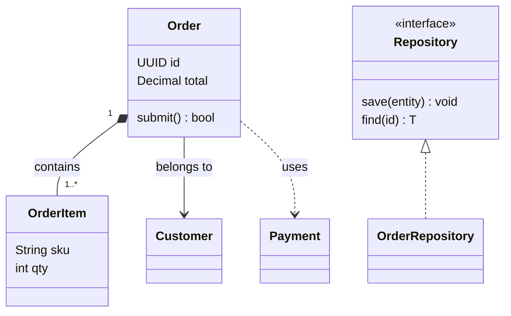

FLOW-TASK: build-software/uml-class
FLOW-TARGET: 订单领域模型 | source: uml-class.mmd | stack: Python 3.10+ / dataclasses / typing | entry: S1 | end: S8
FLOW-RULE: 顺序执行 S1→S8；每步验收通过后勾选 STATUS；类/关系按 §11 模型表实现；范围外变更先问

# 订单领域模型 · 构建逻辑

> 来源: `uml-class.mmd`（UML 类图）｜ 节点: 6 ｜ 关系: 4 ｜ 生成: 2026-11-10

## 0. 任务卡

- **构建什么**: 订单领域模型：`Order` 聚合根、`OrderItem` 实体、`Repository` 接口、`OrderRepository` 实现、`Customer` 与 `Payment` 依赖。
- **成功标志**: 领域类可导入；`Order` 能聚合 `OrderItem`；`OrderRepository` 实现 `Repository`；依赖方向符合类图。
- **非目标**: 不实现数据库驱动、不实现 HTTP API、不实现支付渠道。
- **运行环境**: Python 3.10+，只用标准库 `dataclasses` / `typing`。

## 1. 执行契约

- 按 S 编号施工；§5 的分支步骤只在触发条件成立时执行。
- 每步完成后运行 `- 验收:`，通过才把 §8 的 `[ ]` 改成 `[x]`。
- 类图的属性、操作、关系以 §11 模型表为准；不得增删模型元素。
- 依赖方向必须与类图一致：`Order → Payment` 是依赖，不是组合。
- 遇到模型表与实际代码冲突，停止并写 §9。

## 2. 节点清单

| 节点ID | 功能头 | 原文标签 | 类型 | 入度 | 出度 | 软件落点 | 备注 |
| --- | --- | --- | --- | --- | --- | --- | --- |
| N1 | CLASS | Order | class | 0 | 3 | `domain/order.py` | 聚合根 |
| N2 | CLASS | OrderItem | class | 1 | 0 | `domain/order_item.py` | 实体 |
| N3 | IFACE | Repository | interface | 1 | 0 | `domain/repository.py` | 泛型接口 |
| N4 | CLASS | OrderRepository | class | 0 | 1 | `infra/order_repository.py` | 接口实现 |
| N5 | CLASS | Customer | class | 1 | 0 | `domain/customer.py` | 值对象 |
| N6 | CLASS | Payment | class | 1 | 0 | `domain/payment.py` | 支付端口 |

## 3. 关系清单

| From | To | 条件/标签（原文） | 关系类型 |
| --- | --- | --- | --- |
| N1 | N2 | contains（1..*） | composition |
| N4 | N3 | 实现 Repository | realization |
| N1 | N5 | belongs to | association |
| N1 | N6 | uses | dependency |

## 4. 构建步骤

### S1 {CLASS} · 建立 Order 聚合根
- 节点: N1 (class)
- 目标: 实现订单聚合根，包含属性与提交操作
- 落点: `domain/order.py`
- 动作: 用 `@dataclass` 定义 `id: UUID`、`total: Decimal`、`items: list[OrderItem]`；实现 `submit() -> bool`
- 输入: `OrderItem` 列表
- 产出: `Order` 类
- 验收: `python -c "from domain.order import Order"` 退出码 0
- 下一步: S2

### S2 {CLASS} · 建立 OrderItem 实体
- 节点: N2 (class)
- 目标: 实现订单行实体，包含 SKU 与数量
- 落点: `domain/order_item.py`
- 动作: 用 `@dataclass` 定义 `sku: str`、`qty: int`；校验 `qty > 0`
- 输入: SKU、数量
- 产出: `OrderItem` 类
- 验收: `OrderItem(sku="A-1", qty=1).qty == 1`
- 下一步: S3

### S3 {IFACE} · 定义 Repository 接口
- 节点: N3 (interface)
- 目标: 定义泛型仓储方法契约
- 落点: `domain/repository.py`
- 动作: 定义 `Repository(Generic[T])`，方法 `save(entity: T) -> None`、`find(id: UUID) -> T | None`
- 输入: 领域实体
- 产出: `Repository` 协议/抽象基类
- 验收: `python -c "from domain.repository import Repository"` 退出码 0
- 下一步: S4

### S4 {CLASS} · 实现 OrderRepository
- 节点: N4 (class)
- 目标: 用内存字典实现仓储接口
- 落点: `infra/order_repository.py`
- 动作: `class OrderRepository(Repository[Order])`；实现 `save` / `find`
- 输入: `Order`
- 产出: 可实例化的 `OrderRepository`
- 验收: `repo.save(o); repo.find(o.id) is o`
- 下一步: S5

### S5 {CLASS} · 建立 Customer 值对象
- 节点: N5 (class)
- 目标: 表示订单所属客户
- 落点: `domain/customer.py`
- 动作: 用 `@dataclass(frozen=True)` 定义 `id`、`name`
- 输入: 客户 ID、名称
- 产出: `Customer` 值对象
- 验收: 两个相同字段的 `Customer` 相等
- 下一步: S6

### S6 {CLASS}{RELATION} · 建立 Payment 依赖端口
- 节点: N6 (class)
- 目标: 定义支付依赖，不让领域层依赖具体渠道
- 落点: `domain/payment.py`
- 动作: 定义 `PaymentGateway` 协议；`Order` 只依赖该协议
- 输入: 金额、订单 ID
- 产出: `PaymentGateway` 协议
- 验收: `domain` 包不导入任何 `infra` 模块
- 下一步: S7

### S7 {MSE} · 领域模型单元测试
- 节点: N1 (class)
- 目标: 验证聚合、关系与接口实现
- 落点: `tests/test_order_model.py`
- 动作: 断言 `Order.items` 为列表；`OrderRepository` 是 `Repository` 实例；依赖方向正确；覆盖率 ≥ 80%
- 输入: 领域类
- 产出: 测试报告
- 验收: `pytest tests/test_order_model.py -q` 退出码 0
- 下一步: S8

### S8 {END} · 完成
- 节点: N2 (class)
- 目标: 领域模型可交付
- 落点: `domain/`、`infra/`
- 验收: `python -m compileall domain infra` 退出码 0，且测试通过
- 结果: 类图实现完成，等待接入应用层

## 5. 分支与异常

无。类图不包含运行时分枝。

## 6. 循环与并行

无。类图不包含循环与并行。

## 7. 验收门槛

### G1 · 编译
- 命令: `python -m compileall domain infra`
- 通过: 退出码 0
- 失败: 回到报错文件对应的 S 步骤

### G2 · 单元测试
- 命令: `pytest tests/test_order_model.py -q`
- 通过: 退出码 0，覆盖率 ≥ 80%
- 失败: 回到 S1/S2/S4 检查模型

### G3 · 关系方向
- 命令: `python tools/check_imports.py`
- 通过: `domain` 不导入 `infra`；`OrderRepository` 实现 `Repository`
- 失败: 回到 S4/S6 检查依赖方向

## 8. 执行状态

- [ ] S1 · 建立 Order 聚合根
- [ ] S2 · 建立 OrderItem 实体
- [ ] S3 · 定义 Repository 接口
- [ ] S4 · 实现 OrderRepository
- [ ] S5 · 建立 Customer 值对象
- [ ] S6 · 建立 Payment 依赖端口
- [ ] S7 · 领域模型单元测试
- [ ] S8 · 完成

## 9. 待确认

- 【推断】`Repository` 使用 Python `Protocol` 还是抽象基类；示例按 `Generic[T]` 抽象接口实现。
- 【推断】`Order.items` 的多重性 `1..*` 按“至少一个订单行”实现，构造时校验非空。
- [`?`] `Payment` 在原图中是类还是接口不明确；示例按端口协议实现。

## 10. 回环图



## 11. 模型规格

### 11.1 模型元素

| 元素ID | UML类型 | 名称 | 代码落点 | 实现要点 | 验收 |
| --- | --- | --- | --- | --- | --- |
| N1 | class | Order | `domain/order.py` | 属性 `id: UUID`、`total: Decimal`；操作 `submit(): bool`；聚合 `items` | 可导入、可提交 |
| N2 | class | OrderItem | `domain/order_item.py` | 属性 `sku: String`、`qty: int`；校验数量 | 数量 > 0 |
| N3 | interface | Repository | `domain/repository.py` | 方法 `save(entity): void`、`find(id): T` | 可被实现 |
| N4 | class | OrderRepository | `infra/order_repository.py` | 实现 `Repository[Order]`；内存字典 | 保存后可查回 |
| N5 | class | Customer | `domain/customer.py` | 属性 `id`、`name`；不可变 | 值相等 |
| N6 | class | Payment | `domain/payment.py` | `PaymentGateway` 协议；被 Order 依赖 | 领域层不反向依赖 |

### 11.2 关系/消息

| From | To | 关系/消息 | 顺序/多重性 | 实现 |
| --- | --- | --- | --- | --- |
| N1 | N2 | composition | 1..* | `Order.items: list[OrderItem]`，构造时非空 |
| N4 | N3 | realization | — | `class OrderRepository(Repository[Order])` |
| N1 | N5 | association | 0..1 | `Order.customer: Customer \| None` |
| N1 | N6 | dependency | — | `Order` 依赖 `PaymentGateway` 协议 |

## 附录：flow-json

```flow-json
{
  "name": "order-domain",
  "task": "build-software/uml-class",
  "source": "uml-class.mmd",
  "diagram": "uml-class",
  "nodes": [
    {
      "id": "N1",
      "label": "Order",
      "type": "class",
      "uml_type": "class",
      "attributes": ["id: UUID", "total: Decimal"],
      "operations": ["submit(): bool"],
      "directive": "CLASS"
    },
    {
      "id": "N2",
      "label": "OrderItem",
      "type": "class",
      "uml_type": "class",
      "attributes": ["sku: String", "qty: int"],
      "directive": "CLASS"
    },
    {
      "id": "N3",
      "label": "Repository",
      "type": "interface",
      "uml_type": "interface",
      "operations": ["save(entity): void", "find(id): T"],
      "directive": "IFACE"
    },
    {
      "id": "N4",
      "label": "OrderRepository",
      "type": "class",
      "uml_type": "class",
      "directive": "CLASS"
    },
    {
      "id": "N5",
      "label": "Customer",
      "type": "class",
      "uml_type": "class",
      "directive": "CLASS"
    },
    {
      "id": "N6",
      "label": "Payment",
      "type": "class",
      "uml_type": "class",
      "directive": "CLASS"
    }
  ],
  "edges": [
    {
      "from": "N1",
      "to": "N2",
      "label": "contains",
      "kind": "composition",
      "left_multiplicity": "1",
      "right_multiplicity": "1..*"
    },
    {
      "from": "N4",
      "to": "N3",
      "label": "",
      "kind": "realization"
    },
    {
      "from": "N1",
      "to": "N5",
      "label": "belongs to",
      "kind": "association"
    },
    {
      "from": "N1",
      "to": "N6",
      "label": "uses",
      "kind": "dependency"
    }
  ],
  "steps": [
    { "id": "S1", "node": "N1", "next": ["S2"] },
    { "id": "S2", "node": "N2", "next": ["S3"] },
    { "id": "S3", "node": "N3", "next": ["S4"] },
    { "id": "S4", "node": "N4", "next": ["S5"] },
    { "id": "S5", "node": "N5", "next": ["S6"] },
    { "id": "S6", "node": "N6", "next": ["S7"] },
    { "id": "S7", "node": "N1", "next": ["S8"] },
    { "id": "S8", "node": "N2", "next": [] }
  ],
  "loops": [],
  "assumptions": [
    "【推断】Repository 使用 Generic[T] 抽象接口",
    "【推断】Order.items 至少一个元素"
  ],
  "unresolved": [
    "[?] Payment 是类还是接口不明确"
  ]
}
```
