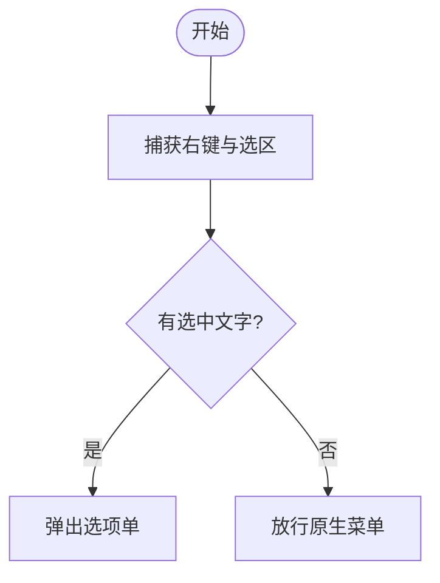

# 逻辑 MD 契约（编译产物格式）

这份文件定义 `*.logic.md` 的固定结构。下游 agent 只依赖这里的字段，不依赖自然语言排版，所以**章节编号、字段名、首 3 行格式都不能改**。

## 1. 首 3 行任务头

文件第一行到第三行必须是下面三行，前面不能有空行、BOM 以外的字符或标题：

```text
FLOW-TASK: build-software
FLOW-TARGET: <名称> | source: <源文件> | stack: <技术栈> | entry: S1 | end: S9
FLOW-RULE: 顺序执行 S1→S9；每步验收通过后勾选 STATUS；判断按实测分支；范围外变更先问
```

### 1.1 `FLOW-TASK`

`FLOW-TASK: <type>` 或 `FLOW-TASK: <type>/<subtype>`。斜杠前是任务类型，必须在枚举内：

| 类型 | 用途 |
| --- | --- |
| `build-software` | 从零构建软件/工具 |
| `extend-software` | 在现有代码库加功能 |
| `fix-software` | 修 bug |
| `refactor-software` | 重构，行为不变 |
| `build-automation` | 脚本 / CI / 发布 / 运维 |
| `build-data-pipeline` | 采集、转换、入库 |
| `build-doc` | 文档 / 报告 / 内容生产 |
| `verify-only` | 只检查，不写功能 |

子类型可自由写，例如 `build-software/desktop-python`、`build-automation/release`。

### 1.2 `FLOW-TARGET`

必须包含：

- `<名称>`：构建什么，一句话。
- `source:` 源图文件名。
- `stack:` 语言/框架/运行环境。
- `entry:` 入口步骤 ID（通常是 `S1`）。
- `end:` 成功终态步骤 ID（可选但推荐）。

### 1.3 `FLOW-RULE`

执行契约，必须包含：

- 顺序范围，如 `顺序执行 S1→S12`。
- “验收”字样。
- “STATUS”字样。
- 判断/循环/阻塞的处理原则。

## 2. 章节骨架

编号固定，顺序固定，不得合并：

| 编号 | 标题 | 作用 |
| --- | --- | --- |
| 0 | 任务卡 | 构建什么、成功标志、非目标 |
| 1 | 执行契约 | 给执行 agent 的规则 |
| 2 | 节点清单 | 图 → 软件落点 |
| 3 | 边清单 | 条件与去向 |
| 4 | 构建步骤 | 主路径 S1..Sn |
| 5 | 分支与异常 | 失败/否定分支步骤 |
| 6 | 循环与并行 | L / P 定义 |
| 7 | 验收门槛 | 总验收 G1..Gn |
| 8 | 执行状态 | 唯一进度源 |
| 9 | 待确认 | `[?]`、`【推断】`、冲突 |
| 10 | 回环图 | Mermaid 重画，用于比对 |
| 11 | 模型规格 | UML 图必填：模型元素 + 关系/消息 |
| 附录 | flow-json | 机器可读图 |

`## 0.` 之前只能有首 3 行和一级标题。一级标题建议：

```markdown
# <名称> · 构建逻辑

> 来源: `<源文件>` ｜ 节点: N ｜ 边: M ｜ 生成: YYYY-MM-DD
```

## 3. 节点清单（§2）

```markdown
| 节点ID | 功能头 | 原文标签 | 类型 | 入度 | 出度 | 软件落点 | 备注 |
| --- | --- | --- | --- | --- | --- | --- | --- |
| N4 | {DB} | 储存数据 | database | 1 | 1 | `snapanswer/store.py` | |
```

- 节点 ID 优先沿用源图；没有就 `N1..Nn`，全文稳定。
- 功能头是可选的 `{TAG}`，用于补充语义；完整目录见 `directive-catalog.md`。
- 类型：`start` / `end` / `process` / `decision` / `io` / `subprocess` / `database` / `parallel` / `note`。
- “软件落点”必须具体到文件、模块或命令，不能写“后端”。

## 4. 边清单（§3）

```markdown
| From | To | 条件/标签（原文） | 边类型 |
| --- | --- | --- | --- |
| N3 | N4 | 是 | yes |
| N3 | N10 | 否 | no |
```

边类型：`normal` / `yes` / `no` / `error` / `loop` / `dashed`。

## 5. 构建步骤（§4 / §5）

### 5.1 普通步骤

```markdown
### S2 {INPUT} · 建立全局钩子与选区探测
- 节点: N2 (io)
- 目标: 右键时判断有没有选中文字，不干扰原生菜单
- 落点: `snapanswer/win32.py`、`snapanswer/selection.py`
- 动作: 安装低级鼠标钩子；用 Ctrl+C + 剪贴板序列号探测选区
- 输入: 鼠标事件、当前剪贴板内容
- 产出: `probe_selection() -> str | None`
- 验收: `python tools/selfcheck.py` 中 selection 用例通过
- 失败: 钩子安装失败 → S10（放行原生菜单）
- 下一步: S3
```

必填：`节点`、`目标`、`落点`、`验收`、`下一步`。
建议：`动作`、`输入`、`产出`、`失败`。

### 5.2 判断步骤

```markdown
### S3 {DQ} · 判断：是否有选中文字
- 节点: N3 (decision)
- 目标: 决定弹面板还是放行原生菜单
- 落点: `snapanswer/selection.py`
- 判定: `probe_selection()` 返回非空且非纯空白
- 是 → S4
- 否 → S10
- 验收: 选中文本返回 True；空白处返回 False
```

必填：`节点`、`目标`、`落点`、`判定`、`验收`、至少两条 `- 是/否 → Sx`。

### 5.3 分支步骤（§5）

```markdown
### S10 {CTIHD} · 放行原生右键菜单
- 节点: N10 (process)
- 触发: S3 = 否
- 目标: 不接管这次右键
- 落点: `snapanswer/win32.py`
- 动作: 成对重放 DOWN/UP，让系统菜单正常出现
- 验收: 空白处右键出现系统菜单
- 下一步: S12
```

必填：`节点`、`触发`、`目标`、`落点`、`验收`、`下一步`。

### 5.4 结束步骤

```markdown
### S9 {END} · 成功结束
- 节点: N9 (end)
- 目标: 答案已写入剪贴板，面板关闭，焦点归还
- 落点: `snapanswer/pipeline.py`
- 验收: 剪贴板内容等于答案；面板不可见；焦点回到原窗口
- 结果: 本次任务结束，等待下次右键
```

必填：`节点`、`目标`、`落点`、`验收`、`结果`；**不要写下一步**。

### 5.5 功能头（`{TAG}`）

功能头写在步骤标题的 S 编号之后，或单独写 `- 指令:`：

```markdown
### S4 {DB}{STORGE} · 储存数据
- 节点: N6 (database)
- 目标: 把本次捕获写入 SQLite
- 落点: `snapanswer/store.py`
- 验收: `SELECT` 能查回本次文本
- 下一步: S5
```

硬性规则：

- `{START}` 通常在 S1；不能与 `{END}` 同用。
- `{END}` 不能有下一步，且必须有 `- 结果:`。
- `{DQ}` / `{OR}` 至少 2 个去向；`{DQ}` 必须有 `- 判定:`。
- `{OR}` 用 `- 分支名 → Sx` 写多选一，不要求 `- 判定:`。
- `{LOOP}` 必须在 flow-json 中有对应回边，§6 必须有退出条件。
- `{LPAR}` 必须有 `- 最大次数:`，或 §6 写明。
- 未知功能头会让校验器 FAIL。

完整目录、组合规则和软性提示见 `directive-catalog.md`。

`## 6. 循环与并行（§6）`

```markdown
### L1 · 失败重试
- 回边: S10 → S3
- 继续条件: 测试失败且尝试次数 < 3
- 退出条件: 测试通过，或尝试次数 = 3
- 最大次数: 3
- 超限: → S12 人工介入
```

没有循环/并行时写“无”，但章节不能删。

并行：

```markdown
### P1 · 捕获与作答并行
- fork: S4
- 分支: 捕获线程 / 作答线程
- join: S8
- 共享状态: `run_id`、取消标志
- 冲突处理: 新任务取消旧任务
```

## 7. 验收门槛（§7）

```markdown
### G1 · 离线自检
- 命令: `python tools/selfcheck.py`
- 通过: 退出码 0，且输出 `31/31`
- 失败: 回到失败用例对应的 S 步骤

### G2 · 端到端
- 命令: `python tools/flow_check.py`
- 通过: 输出 `32/32`，无异常堆栈
```

每个 G 必须有 `命令` 和 `通过`；能自动化的不要写成“人工看一眼”。

## 8. 执行状态（§8）

每个步骤一行，顺序与 §4/§5 一致：

```markdown
- [ ] S1 · 项目骨架
- [ ] S2 · 全局钩子与选区探测
- [x] S3 · 判断：是否有选中文字
```

规则：

- 这是**唯一**进度源；步骤详情里不再写 `- 状态:`。
- 完成并通过验收才改 `[x]`。
- 失败保持 `[ ]`，并在 §9 记录。
- 不允许出现未知 S 或重复 S。

## 9. 待确认（§9）

```markdown
- [`?`] 图右下角注释无法辨认，可能是“最多重试 3 次”。
- 【推断】任务类型按 `build-software` 处理，因为图中有完整 UI 流程。
- 【冲突】图中写 `Ctrl+C` 探测，但设计文档要求不污染剪贴板；执行时优先回填。
```

## 10. 回环图（§10）

用 Mermaid 按步骤重画，边集合必须与源图一致：

````markdown

````

## 10.5 UML 模型规格（§11）

只有 `diagram` 为 `uml-*` 时需要。固定两张表：

```markdown
## 11. 模型规格

### 11.1 模型元素

| 元素ID | UML类型 | 名称 | 代码落点 | 实现要点 | 验收 |
| --- | --- | --- | --- | --- | --- |
| N1 | class | Order | `domain/order.py` | 属性 id/total；操作 submit | 可导入 |

### 11.2 关系/消息

| From | To | 关系/消息 | 顺序/多重性 | 实现 |
| --- | --- | --- | --- | --- |
| N1 | N2 | composition | 1..* | `Order.items` |
| N1 | N2 | POST /orders | 1 | `api/orders.py` |
```

规则：

- 11.1 覆盖 flow-json 的所有 `nodes[].id`；11.2 覆盖所有 `edges` 的 `from`→`to`。
- 表头必须包含 `元素ID`、`UML类型`、`From`、`To`、`关系`/`消息`，否则校验器无法解析。
- 类图：11.2 写 `多重性`（如 `1..*`）；实现列写字段/方法。
- 时序图：11.2 写 `顺序`（1..N）且连续；实现列写调用/端点。
- 状态机：11.2 写 `事件`、`守卫`、`动作`。
- 用例图：11.1 区分 `actor`/`usecase`；11.2 写关联/include/extend。
- 组件/部署：11.1 写组件/节点/artifact；11.2 写连接与协议。
- ER：11.1 写实体与字段；11.2 写关系与基数。

## 11. flow-json（附录）

放在文件末尾，用 ` ```flow-json ` 围栏。schema：

```json
{
  "name": "snapanswer",
  "task": "build-software",
  "source": "自动作答流程.ngm",
  "diagram": "flowchart",
  "nodes": [
    {
      "id": "N1",
      "label": "开始",
      "type": "start",
      "directive": "START"
    },
    {
      "id": "N3",
      "label": "有选中文字?",
      "type": "decision",
      "directive": "DQ"
    }
  ],
  "edges": [
    {
      "from": "N1",
      "to": "N2",
      "label": "",
      "kind": "normal"
    },
    {
      "from": "N3",
      "to": "N4",
      "label": "是",
      "kind": "yes"
    }
  ],
  "steps": [
    {
      "id": "S1",
      "node": "N1",
      "next": ["S2"]
    },
    {
      "id": "S3",
      "node": "N3",
      "next": ["S4", "S10"]
    }
  ],
  "loops": [],
  "assumptions": ["【推断】任务类型为 build-software"],
  "unresolved": ["[?] 图右下角注释无法辨认"]
}
```

约束：

- `nodes[].id` 唯一；`edges` 的 `from`/`to` 必须存在。
- `diagram` 可选值：`flowchart`、`uml-class`、`uml-sequence`、`uml-state`、`uml-er`、`uml-usecase`、`uml-component`、`uml-deployment`、`uml-activity`。
- UML 节点可带 `uml_type`、`attributes[]`、`operations[]`、`state_kind`、`stereotype`。
- UML 边可带 `order`（时序）、`message_kind`、`guard`、`action`、`left_multiplicity`、`right_multiplicity`。
- `nodes[].directive` 可选，必须是 `directive-catalog.md` 里的 tag；`directives` 可选，用于多个功能头。
- `steps[].id` 与正文步骤集合完全一致；`steps[].node` 必须是节点。
- 每个节点至少被一个步骤引用。
- 每个 decision 至少 2 条出边；非 end 节点必须有出边。
- 所有节点从起点可达，且都能到达 end。
- 有回边时，§6 必须有对应 `L` 循环与 `退出条件`。

## 12. 校验命令

```powershell
python scripts/logic_check.py "xxx.logic.md"
python scripts/logic_check.py "xxx.logic.md" --mermaid
```

`logic_check.py` 以退出码 1 表示存在 FAIL。交付前必须 `FAIL 0`。
